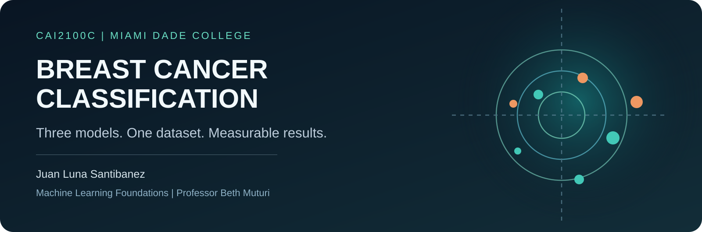
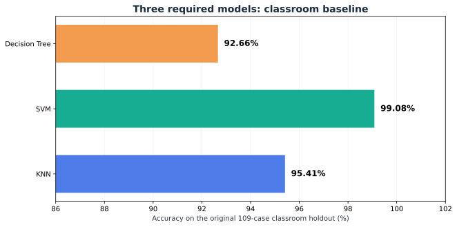
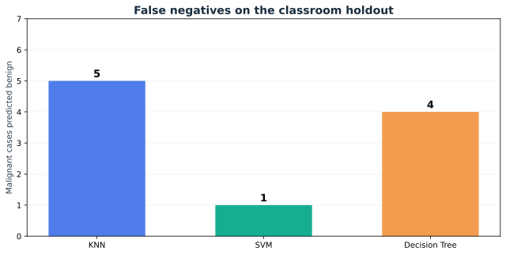

<div align="center">

# Breast Cancer Classification | Project 1

### Miami Dade College | CAI2100C-2267-6908 | Machine Learning Foundations

**Juan Luna Santibanez**  
**Professor Beth Muturi**  
**Supervised Machine Learning | October 2026**


**Three classifiers. One consistent dataset. An honest comparison.**

[**Google Colab: Course Notebook**](https://colab.research.google.com/github/SupaHumano/CAI2100C-Breast-Cancer-Classification/blob/main/academic/Project_1_Course_Submission.ipynb) · [**Research Notebook**](notebooks/Project_1_Research_Validation.ipynb) · [**Interactive Lab**](https://supahumano.github.io/CAI2100C-Breast-Cancer-Classification/) · [**Kaggle Setup**](#kaggle-notebooks)

</div>



---

[Overview](#overview) · [Course assignment](#the-course-assignment) · [Workflow](#the-learning-workflow) · [Results](#model-results) · [Interpretation](#what-does-99-actually-mean) · [Run](#run-the-project) · [Structure](#project-structure) · [Sources](#sources-and-context)

## Overview

This academic project compares **K-Nearest Neighbors (KNN)**, **Support Vector Machine (SVM)** and **Decision Tree** for classifying labeled breast mass observations using measurements from the Wisconsin Diagnostic Breast Cancer data provided in class. The available labels are **B (benign)** and **M (malignant)**. This dataset does not directly label invasive versus non-invasive disease.

The goal is to build and compare three reproducible supervised classifiers, explain how the results are measured, and propose a responsible deployment approach. **This is an educational exercise, not a tool for medical diagnosis or screening.**

## The Course Assignment

Professor Beth Muturi provided an instructor-guided Jupyter Notebook with six stages of the AI Project Cycle. The assignment asks for all three algorithms, an evaluation of their classification performance, a reasoned best-model decision, and a deployment proposal.

| Course stage | Working output |
|---|---|
| Understand the problem | Define the label and the practical classification question |
| Data acquisition | Use the actual MDC CSV with the diagnosis column |
| Data exploration | Inspect and clean missing values; encode labels; visualize correlations |
| Modeling | Train KNN, SVM and Decision Tree |
| Evaluation | Report test scores, confusion matrices and classification metrics |
| Deployment | Explain where and how a model could be used with adequate safeguards |

**Project format:** Individual work by Juan Luna Santibanez, as approved by Professor Beth Muturi. The course deadline stated in class was **Friday, October 30, 2026, at 11:00 PM**. Confirm any updated date in Canvas.

## The Learning Workflow


### What the source data contains

The course-provided file has **569 observations** and **32 columns**, including the administrative `id` column and the binary `diagnosis` target. There are **28 missing data cells** affecting **26 rows**. Following the classroom notebook's selected approach, complete-case cleaning leaves **543 observations**: 342 benign and 201 malignant.


The classroom baseline deliberately follows the provided instructional template. Separate research experiments exclude the non-clinical `id` and use preprocessing pipelines to protect held-out data against leakage. **Do not confuse the classroom baseline with the additional research evaluation.**

## Model Results

### Three required algorithms, same 109-case classroom split



| Required model | Classroom test accuracy | Missed malignant cases | Malignant recall |
|---|---:|---:|---:|
| KNN | 95.41% | 5 | 87.50% |
| **SVM** | **99.08%** | **1** | **97.50%** |
| Decision Tree | 92.66% | 4 | 90.00% |


The confusion matrix separates actual labels (rows) from predicted labels (columns). A **false negative** is a malignant sample predicted as benign. On the fixed classroom split, SVM had one such error.



### A more demanding development-only estimate


| Required model | Four-fold nested validation, mean accuracy |
|---|---:|
| KNN | 95.40% |
| **SVM** | **97.93%** |
| Decision Tree | 95.86% |

These estimates are based on nested validation within the **434 development observations**. The original 109-case test set was already examined and therefore cannot be described as fresh external validation. The nested procedure tests hyperparameter selection in separate development folds.

## What Does 99% Actually Mean?

SVM classified **108 of the 109** cases in one classroom test partition correctly. That result is real for the specified test. It does **not** mean SVM will always achieve 99% on new patients or in clinical use.

The more demanding nested estimate, **97.93%**, is lower, and additional preprocessing experiments showed both positive and negative results. I therefore select SVM as the strongest of the three required candidates in this coursework while keeping its limitations visible.

The research appendix also compares optional logistic regression and random forest baselines. Those methods are **not additional requirements from the professor** and remain separate from the graded three-model comparison.

## Interactive Lab

The [interactive visualization](https://supahumano.github.io/CAI2100C-Breast-Cancer-Classification/) allows readers to examine each of the three required models, understand confusion-matrix cells, compare false negatives and view the difference between the classroom holdout and nested validation. It visualizes existing, reproducible results. **It is not a medical classifier and does not accept patient data.**

## Run the Project

### Google Colab

[**Open the course notebook in Colab**](https://colab.research.google.com/github/SupaHumano/CAI2100C-Breast-Cancer-Classification/blob/main/academic/Project_1_Course_Submission.ipynb). Colab may ask you to upload **`[Dataset]_BreastCancer.csv`** from the repository. Select **Runtime > Run all**. Confirm the student identification and share the actual Colab URL using the access setting the instructor requests.

[**Open the research notebook in Colab**](https://colab.research.google.com/github/SupaHumano/CAI2100C-Breast-Cancer-Classification/blob/main/notebooks/Project_1_Research_Validation.ipynb) to examine optional research experiments separately.

### Kaggle Notebooks

Open [Kaggle Code](https://www.kaggle.com/code), import either `.ipynb` from this repository, and upload the supplied CSV as an input dataset. The notebooks are Jupyter-compatible, but the original classroom loader expects the data in the working directory. The loader searches Kaggle input directories for the exact classroom CSV file automatically. There is **no independently published Kaggle notebook URL** yet.

### Local Jupyter

```bash
git clone https://github.com/SupaHumano/CAI2100C-Breast-Cancer-Classification.git
cd CAI2100C-Breast-Cancer-Classification
python -m pip install -r requirements.txt
jupyter notebook academic/Project_1_Course_Submission.ipynb
```

The CSV is stored beside the course notebook so the original loader can find it locally.

## Project Structure

```text
CAI2100C-Breast-Cancer-Classification/
├── README.md                         Research overview and walkthrough
├── index.html                        Interactive educational site
├── assets/                           Original figures and visual explanations
├── academic/
│   ├── Project_1_Course_Submission.ipynb
│   └── [Dataset]_BreastCancer.csv
├── notebooks/
│   └── Project_1_Research_Validation.ipynb
├── data/                              Instructor dataset and provenance record
├── research/                          Original calculated benchmark results
├── docs/
│   ├── METHODOLOGY.md
│   ├── PRESENTATION_GUIDE.md
│   └── REQUIREMENTS.md
├── tests/                             Local verification checks
├── requirements.txt
└── .gitignore
```

## Sources and Context

The classroom notebook was completed using the **MDC instructor-provided template** and CSV. The separate research notebook documents optional methodology, including nested CV and feature-processing comparisons. Public reference implementations were used for conceptual comparison only, not copied into the code.

- Miami Dade College, CAI2100C Machine Learning Foundations. **Project 1: Practical Application of a Supervised Learning Model**, Professor Beth Muturi.
- [scikit-learn: Common pitfalls and data leakage](https://scikit-learn.org/stable/common_pitfalls.html)
- [scikit-learn: Nested versus non-nested cross-validation](https://scikit-learn.org/stable/auto_examples/model_selection/plot_nested_cross_validation_iris.html)
- [UCI Machine Learning Repository: WDBC](https://archive.ics.uci.edu/dataset/17/breast-cancer-wisconsin-diagnostic)

---

<div align="center">**Juan Luna Santibanez | Miami Dade College | CAI2100C**</div>
