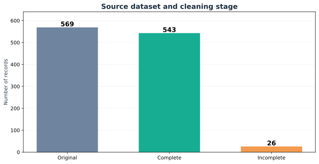
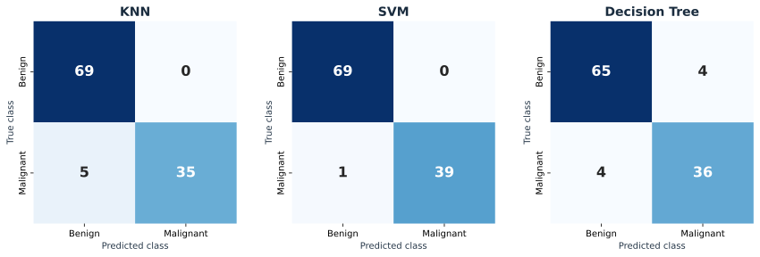
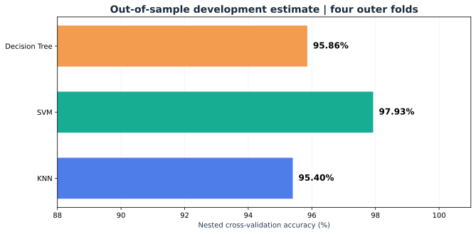

# Oral Presentation and Technical Q&A

**Project 1 | Breast Cancer Classification**  
**Juan Luna Santibanez**  
Miami Dade College · CAI2100C-2267-6908 · Machine Learning Foundations  
Professor Beth Muturi · October 2026

## 1. Problem and Objective

**Research question:** How accurately can K-Nearest Neighbors (KNN), Support Vector Machine (SVM), and Decision Tree classify labeled breast mass measurements as benign or malignant, and what do their mistakes reveal about reliability?

My objective is to compare three supervised classifiers on the same classroom dataset and test partition. I examine accuracy, class-specific recall, and confusion matrices rather than evaluating performance by a single number. I also investigate generalization with separate nested cross-validation experiments.

**Scope:** This is a reproducible educational analysis, not a medical diagnosis, screening, or treatment system.

## 2. Proposed Solution

I follow six stages of the machine learning project cycle:

| Stage | Implementation | Outcome |
|---|---|---|
| Problem scoping | Define a binary supervised classification objective | Predict the recorded `diagnosis` label |
| Data acquisition | Load the course-provided diagnostic CSV | 569 original observations |
| Data exploration | Check completeness, encode labels, visualize correlations | 543 complete observations |
| Modeling | Train KNN, SVM, and Decision Tree | Three classroom classifiers |
| Evaluation | Analyze accuracy, recall, and confusion matrices | Error-aware comparison on 109 test cases |
| Deployment | Present a reproducible educational visualization | No clinical predictions or patient data |

## 3. Dataset and Preprocessing

The supplied dataset contains **569 rows and 32 columns**: the `id` identifier, the `diagnosis` target, and 30 numerical diagnostic features. There are **28 missing cells across 26 different rows**. After complete-case deletion, the dataset contains **543 records**, with **342 benign (B)** and **201 malignant (M)** labels.

I encode **B = 0** and **M = 1**, then create a seeded, stratified **434-row development / 109-row test** split. The test partition contains 69 benign and 40 malignant observations. The classroom approach keeps the input specification of the supplied course notebook. My separate research pipelines exclude administrative `id`, because it is not a biological measurement.

I fit scaling parameters using training data only for scale-sensitive models. The research notebook places preprocessing inside cross-validation pipelines to limit data leakage. I use correlations to explore patterns, not to claim causality.

## 4. Methods

**KNN:** Compares a new observation with labeled neighbors in feature space. Distance and scaling influence the outcome. The classroom baseline uses two neighbors.

**SVM:** Learns a separating boundary with a margin-based objective. Standardized feature values help avoid undue influence from different measurement scales.

**Decision Tree:** Learns recursive feature-based splitting rules. Trees are interpretable but can overfit training samples; unpruned complexity must be checked against held-out performance.

I use a consistent classroom test set for all three classifiers, then distinguish the additional research design from the original classroom specification.

## 5. Results and Model Selection

### Classroom test: 109 cases

| Metric | KNN | SVM | Decision Tree |
|---|---:|---:|---:|
| Correct classifications | 104 | **108** | 101 |
| Test accuracy | 95.41% | **99.08%** | 92.66% |
| True negatives (TN) | 69 | 69 | 65 |
| False positives (FP) | 0 | 0 | 4 |
| False negatives (FN) | 5 | **1** | 4 |
| True positives (TP) | 35 | **39** | 36 |
| Malignant recall | 87.50% | **97.50%** | 90.00% |

In each confusion matrix, **rows are actual labels and columns are predicted labels**, ordered `[B, M]`. Thus `[[TN, FP], [FN, TP]]`. Here a false negative means an observation labeled malignant was predicted benign.

### Development-only nested cross-validation

| Model | Mean accuracy | Mean malignant recall |
|---|---:|---:|
| KNN | 95.40% | 90.69% |
| **SVM** | **97.93%** | **95.05%** |
| Decision Tree | 95.86% | 92.56% |

Nested validation separates inner hyperparameter selection from four outer evaluation folds on the **434 development records**. This research specification excludes `id`. The 109-row holdout had already been examined; neither its 99.08% score nor the nested estimate represents prospective external clinical validation. These protocols should not be described as identical experiments.

**Model selection:** SVM is the strongest of the three required candidates in the evaluated classroom split and has the highest mean nested accuracy in the additional research. I still report its false negative, the variability across validation folds, and the limitations of the dataset.

## 6. Technical Q&A

### Problem and data

**Q01. What problem am I solving?**  
I classify recorded breast mass measurements into the known dataset categories benign and malignant, then compare the reliability and errors of three learning algorithms.

**Q02. Why is this supervised learning?**  
Every training observation includes numerical inputs and a known diagnosis label. The algorithms learn the mapping between them.

**Q03. What is the target variable?**  
`diagnosis`, encoded as benign `B = 0` and malignant `M = 1`. I treat malignant as the positive class when computing recall and false negatives.

**Q04. Does malignant mean invasive breast cancer?**  
No. The supplied labels are benign and malignant. They do not establish stage, invasive status, or a complete clinical diagnosis.

**Q05. How much data did I start with?**  
569 records and 32 columns, including 30 measurements, one identifier, and one diagnosis label.

**Q06. How much data remains after cleaning?**  
543 observations: 342 benign and 201 malignant. Removing 26 incomplete rows reduced the record count from 569 to 543.

**Q07. Why were there 28 missing values but 26 removed rows?**  
Missing cells and incomplete observations are different quantities; some rows contain more than one missing cell.

**Q08. Why did I remove incomplete rows instead of imputing?**  
Complete-case deletion follows the classroom procedure and is reproducible. It also discards information. A separate imputation comparison would require fitting the imputer only on training folds.

**Q09. Is the dataset balanced?**  
No. There are more benign than malignant observations. I therefore inspect class-level recall and the confusion matrix as well as accuracy.

**Q10. What does the correlation heatmap show?**  
It displays statistical relationships among measurements. Correlation indicates association, not causation or clinical significance.

### Algorithms and training

**Q11. How is the data split?**  
With a stratified 80/20 split and `random_state = 42`: 434 development observations and 109 held-out observations.

**Q12. Why stratify?**  
Stratification approximately preserves the class proportions in the two partitions and reduces accidental class-distribution differences.

**Q13. Why keep a test set?**  
It provides a held-out evaluation separate from parameter fitting. Reusing it for model selection would weaken the independence of the estimate.

**Q14. What is data leakage?**  
Leakage occurs when information from evaluation data influences training or parameter choices, for example fitting a scaler before splitting the data.

**Q15. Why use StandardScaler?**  
KNN distances and SVM optimization are sensitive to numerical scale. I fit scaling parameters on the training partition, then transform the evaluation data.

**Q16. How does KNN work?**  
It assigns a label using nearby labeled examples in the feature space. The classroom model uses `n_neighbors = 2`.

**Q17. How does SVM work?**  
It learns a decision boundary that separates classes using a margin-based objective; observations close to the boundary influence the fitted classifier.

**Q18. How does Decision Tree work?**  
It recursively splits the feature space with decision rules. Deep or unrestricted splitting can overfit training patterns.

**Q19. Why these three algorithms?**  
They compare distance-based, margin-based, and rule-based approaches under the same classroom conditions.

**Q20. What are hyperparameters?**  
Settings selected before training, such as neighbor count, SVM regularization and kernel, or tree depth. They are different from parameters learned from training data.

**Q21. Why remove `id` from the research features?**  
It is an administrative record identifier, not a biological measurement. I retained the course-template baseline separately and excluded `id` in the extended research.

**Q22. What is a preprocessing pipeline?**  
A sequence of transformations and an estimator fitted together. Inside cross-validation, each training fold fits its own preprocessing to prevent leakage into the evaluation fold.

### Evaluation and interpretation

**Q23. What is accuracy?**  
Correct predictions divided by all predictions. Classroom SVM achieved **108 / 109 = 99.08%**.

**Q24. What is a confusion matrix?**  
It counts correct and incorrect predictions for each actual class. With benign then malignant ordering, SVM's classroom matrix is `[[69, 0], [1, 39]]`.

**Q25. What is a false negative?**  
A malignant observation predicted benign. Counts: **KNN 5, SVM 1, Decision Tree 4**.

**Q26. What is a false positive?**  
A benign observation predicted malignant. Counts: **KNN 0, SVM 0, Decision Tree 4**.

**Q27. What is malignant recall?**  
`TP / (TP + FN)`. It measures the share of actual malignant observations correctly identified: **87.50%, 97.50%, and 90.00%**, respectively.

**Q28. What is precision?**  
`TP / (TP + FP)`: the share of observations predicted malignant that actually have a malignant label.

**Q29. What is F1-score?**  
The harmonic mean of precision and recall. It summarizes their balance but does not replace an examination of individual errors.

**Q30. Which model performed best?**  
SVM had the highest classroom test accuracy, the fewest missed malignant examples, and the highest mean nested accuracy in the separate research analysis.

**Q31. Why not promise 99% accuracy?**  
99.08% was measured on one specific, previously examined holdout. Performance on different data can be lower or higher.

**Q32. What is overfitting?**  
A model learns sample-specific patterns that do not generalize. The classroom Decision Tree scored **100% on training data** but **92.66% on the test set**, a warning to investigate.

**Q33. What is cross-validation?**  
It rotates training and validation folds on the development data to evaluate variation across partitions.

**Q34. What is nested cross-validation?**  
Inner folds select hyperparameters; separate outer folds evaluate that selection procedure. My research uses four outer folds.

**Q35. Why are classroom and nested results different?**  
They involve different partitions and model specifications. The nested research removes `id` and uses fold-contained preprocessing and tuning; the results are not interchangeable.

**Q36. What are the nested accuracy estimates?**  
**KNN 95.40%, SVM 97.93%, Decision Tree 95.86%** on the 434-row development population under the recorded procedure.

### Extensions, limitations and deployment

**Q37. Which optional models did I examine?**  
Logistic Regression and Random Forest, as separate exploratory comparisons, not replacements for the three required models.

**Q38. Which additional transformations did I test?**  
Robust scaling, Yeo–Johnson power transformation, PCA, and SelectKBest. I compared these within the research validation protocol.

**Q39. Did every transformation improve the results?**  
No. The Yeo–Johnson SVM experiment averaged **98.16%** nested accuracy, whereas the SelectKBest variant averaged approximately **94.47%**.

**Q40. Why not select a model using the already examined holdout?**  
Repeatedly choosing parameters according to the same holdout introduces selection bias and makes its score optimistic.

**Q41. Why are false negatives important?**  
They represent missed malignant labels within this dataset. Their clinical consequences would require separate medical evidence and an approved decision process.

**Q42. Can I claim this is a medical diagnostic device?**  
No. It is an educational experiment without external clinical validation or approval for patient use.

**Q43. How would I deploy the educational system?**  
I would use a versioned notebook and read-only interactive visualization, preserve the preprocessing recipe, document the data source, and display limitations. No patient data or live medical decisions are involved.

**Q44. What would clinical deployment require?**  
Independent clinical cohorts, prospective validation, privacy protection, subgroup error assessment, clinical oversight, monitoring, and applicable regulatory review.

**Q45. How is the work reproducible?**  
The repository preserves the original CSV and its SHA-256 checksum, implementation settings, executed notebooks, results files, dependency specifications, and the distinction between classroom and research experiments.

## 7. Closing Statement

I compared three distinct supervised learning methods using a common educational dataset. SVM achieved the strongest classroom and nested-validation results among the assigned models. My main conclusion is that a credible machine learning result depends not only on accuracy, but also on correct data preparation, error analysis, evaluation design, and a clear boundary between classroom evidence and clinical use.

## Project Materials

[Academic Notebook](../academic/Project_1_Course_Submission.ipynb) · [Research Notebook](../notebooks/Project_1_Research_Validation.ipynb) · [Methodology](METHODOLOGY.md) · [Requirements](REQUIREMENTS.md) · [Interactive Presentation](../index.html)
